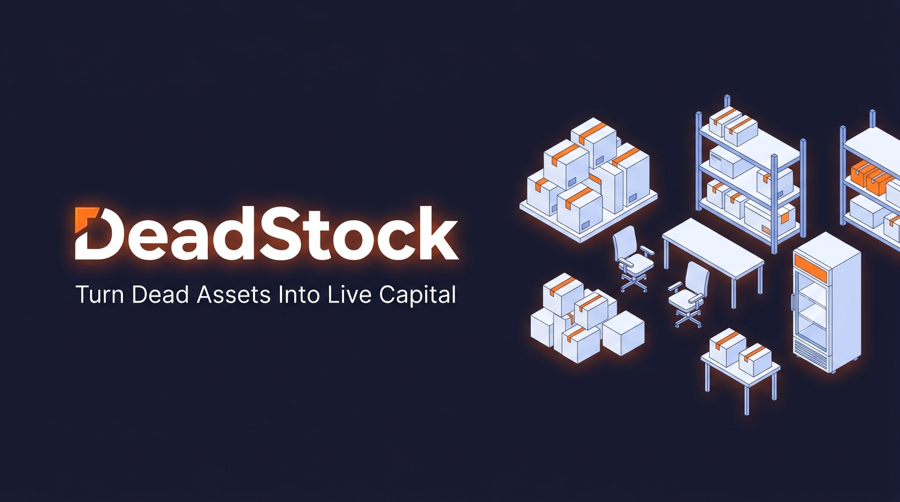

# 📦 DeadStock — B2B Marketplace for Surplus Commercial Assets

> **"Turn Dead Assets Into Live Capital"**  
> A dedicated circular economy ReCommerce platform where businesses sell surplus commercial equipment, furniture, and fixtures directly to other businesses — with zero scrap yard middlemen.

🚀 **Live Production Deployment**: [https://deadstock-five.vercel.app](https://deadstock-five.vercel.app)  
📁 **GitHub Repository**: [https://github.com/Legend-1s-here/DeadStock](https://github.com/Legend-1s-here/DeadStock)



---

## 🌟 The Problem & The DeadStock Solution

- **The Problem**: When small and medium businesses (restaurants, cafes, retail boutiques, startups) close, relocate, or remodel, commercial lease deadlines force them to surrender high-value assets (commercial refrigerators, POS terminals, solid teak chairs, warehouse shelving) to scrap dealers (*kabadiwalas*) for pennies on the dollar (5–10% of CapEx value).
- **The Buyer Pain**: At the same time, new entrepreneurs burn 40–60% of their seed runway purchasing brand-new commercial fixtures at full retail price.
- **Why Alternatives Fail**: Consumer classifieds (OLX, Facebook Marketplace) are plagued by retail bargain hunters wanting single items, scam bots, and zero support for bulk lot transactions or GST invoicing.
- **The DeadStock Difference**: Verified B2B-only marketplace with bulk lot pricing, automated commercial condition ratings, AI asset valuation, and a real-time counter-offer negotiation engine.

---

## 🚀 Key Features

1. **AI Commercial Asset Valuator (`/ai-valuator`)**:
   - Models real-world commercial equipment depreciation curves.
   - Calculates fair secondary market value, quick liquidation price (for tight lease deadlines), and scrap dealer comparison (proving 5x–8x higher capital recovery).
   - Generates instant pre-filled listings from appraisals.

2. **Gemini AI Auto-Listing Assistant (`/listings/new`)**:
   - Type a single sentence summary (e.g., *"40 teak restaurant chairs bought in 2023 for 4000 each in Bandra"*).
   - Gemini AI estimates fair resale prices, writes professional commercial copy, selects condition, and populates the form in seconds.

3. **Commercial Catalog & Real-Time Filtering (`/browse`)**:
   - Instant search by keyword, brand, or model.
   - Multi-parameter filtering by sector (*Commercial Kitchen, Office Furniture, Retail Displays, IT & POS Hardware, Industrial Equipment*), physical condition, metro city (*Mumbai, Delhi NCR, Bangalore, Pune, Hyderabad*), and price range.
   - Toggle between 3-column Grid and List views with instant sorting.

4. **B2B Offer & Counter-Offer Negotiation Engine**:
   - Dynamic **Make an Offer** modal with quick preset discounts (**-10%**, **-15%**, **-20%**), lot quantity selection, and logistics preference picker (*Buyer Pickup*, *Seller Delivery*, *DeadStock Freight*).
   - Sellers can **Accept Deal**, **Propose Counter-Offer**, or **Decline** directly from their merchant portal.

5. **Unified Merchant Dashboard (`/dashboard`)**:
   - Manage active commercial listings, incoming bids, sent offers, and saved watchlists.
   - Real-time analytics on asset value listed and capital recovered.

6. **Verified GST Merchant Profiles (`/profile/[id]`)**:
   - Public business storefront displaying verified GSTIN, merchant score, operating city, and active inventory catalog.

---

## 🛠️ Tech Stack

- **Framework**: [Next.js 15 (App Router)](https://nextjs.org/) with React 19 & TypeScript
- **Styling**: [Tailwind CSS v4](https://tailwindcss.com/) with custom industrial B2B color palette
- **Database**: SQLite via [Prisma ORM](https://www.prisma.io/) (`prisma/dev.db`)
- **Authentication**: [NextAuth.js](https://next-auth.js.org/) with credentials provider & JWT session augmentation
- **Icons**: [Lucide React](https://lucide.dev/)
- **Data Seeding**: Pre-loaded with 4 verified businesses, 10 commercial listings, and live negotiation threads

---

## ⚡ Quickstart & Setup

### 1. Clone the repository
```bash
git clone https://github.com/Legend-1s-here/DeadStock.git
cd DeadStock
```

### 2. Install dependencies
```bash
npm install
```

### 3. Initialize & Seed Database
```bash
# Push Prisma schema to SQLite
npm run db:push

# Seed with realistic commercial assets and demo accounts
npm run db:seed
```

### 4. Start Development Server
```bash
npm run dev
```
Open **[http://localhost:3000](http://localhost:3000)** in your browser.

---

## 🔑 Pre-Seeded Demo Accounts

Test the platform immediately with 1-click login buttons on the `/auth/login` page:

| Persona | Email | Business | City | Role | Password |
|---|---|---|---|---|---|
| **Rajesh Kumar** | `spice.garden@demo.com` | Spice Garden Restaurant | Mumbai | Seller (F&B) | `password123` |
| **Neha Sharma** | `trendz.store@demo.com` | Trendz Boutiques | Delhi NCR | Buyer (Retail) | `password123` |
| **Vikram Mehta** | `techbridge@demo.com` | TechBridge Solutions | Bangalore | Office Facility Lead | `password123` |
| **Priya Shrivastava** | `priya@deadstock.in` | DeadStock Asset Recovery | Mumbai | Inspector / Admin | `password123` |

---

## 📈 Market Size & Financial Model

- **Total Addressable Market (TAM)**: USD 48 Billion (2023) — Secondary commercial equipment & surplus business inventory.
- **Growth Rate (CAGR)**: 14.2% CAGR (2023–2030)
- **Business Model**: 8% – 10% platform commission on completed commercial asset sales.
- **Projections**:
  - Year 1: ~₹72,000 – ₹1.5L revenue (Initial metro pilot)
  - Year 2: ~₹2.5L – ₹4.5L revenue (3 metro hubs)
  - Year 3: ~₹6L – ₹10L+ revenue (Pan-India expansion)

---

## 📄 License & Course Context

Built as part of the **Wadhwani Foundation Venture Fast Track Program (NEN WF Global)**.  
© 2026 DeadStock Technologies Pvt. Ltd. All rights reserved.
